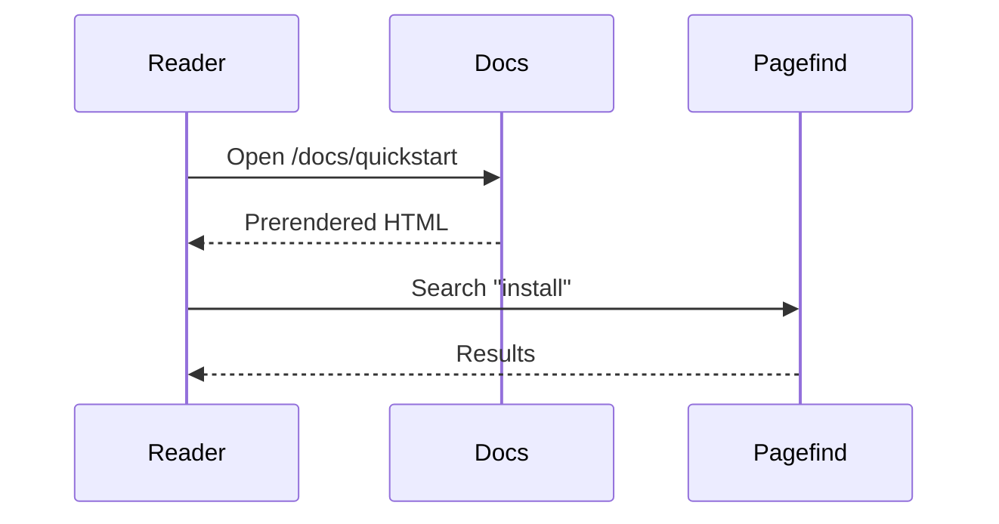

# Components

Each section below uses one component. Nothing on this page imports anything.

## Callouts

<Callout type="info">A `Callout` with `type="info"`.</Callout>
<Note>A note.</Note>
<Tip>A tip.</Tip>
<Info>Some information.</Info>
<Warning>Something to be careful about.</Warning>
<Danger>Something that breaks things.</Danger>
<Check>Something that worked.</Check>

:::warning
A callout written as a directive, `:::warning`.
:::

## Cards

<CardGroup cols={3}>
  <Card title="Fast" icon="zap">Prerendered pages, client-side search.</Card>
  <Card title="Themeable" icon="palette">One token file restyles everything.</Card>
  <Card title="Linked" icon="link" href="/quickstart">A card that links somewhere.</Card>
</CardGroup>

<Card title="A horizontal card" icon="layout" horizontal>
  Cards can sit on their own, too.
</Card>

## Columns

<Columns cols={2}>
  <div>The first column holds any Markdown.</div>
  <div>So does the second one.</div>
</Columns>

## Steps

<Steps>
  <Step title="Write">Add an `.mdx` file under `content/docs`.</Step>
  <Step title="Register">List it in `docs.json`.</Step>
  <Step title="Ship">Build and deploy.</Step>
</Steps>

## Tabs

<Tabs>
  <Tab title="macOS">Press <kbd>⌘</kbd> <kbd>K</kbd> to open search.</Tab>
  <Tab title="Windows">Press <kbd>Ctrl</kbd> <kbd>K</kbd> to open search.</Tab>
  <Tab title="Linux">Press <kbd>Ctrl</kbd> <kbd>K</kbd> there too.</Tab>
</Tabs>

## Accordions

<AccordionGroup>
  <Accordion title="Is it responsive?">Yes. The sidebar becomes a drawer on small screens.</Accordion>
  <Accordion title="Does it support dark mode?">Yes, with the toggle in the header.</Accordion>
</AccordionGroup>

<Accordion title="A single accordion, open by default" defaultOpen>
  Accordions work without JavaScript: they're `<details>` elements.
</Accordion>

## Code groups

<CodeGroup>
```bash title="npm"
npm install @inkform/astro
```

```bash title="pnpm"
pnpm add @inkform/astro
```

```bash title="yarn"
yarn add @inkform/astro
```
</CodeGroup>

## Parameter and response fields

<ParamField query="limit" type="integer" default="20">
  The maximum number of results to return.
</ParamField>

<ParamField path="id" type="string" required>
  The plant's id.
</ParamField>

<ResponseField name="id" type="integer" required>
  The id of the created record.
</ResponseField>

<Expandable title="Show the nested fields">
  <ResponseField name="owner.name" type="string">Who owns it.</ResponseField>
</Expandable>

## Frames and embeds

<Frame caption="A framed image.">
  
</Frame>

<Embed provider="youtube" url="https://www.youtube.com/watch?v=dQw4w9WgXcQ" />

## Tooltips

Hover <Tooltip tip="Static Site Generation">SSG</Tooltip> to see its tooltip.

## Diagrams



<Mermaid chart={"graph TD\n  A[Write MDX] --> B[Build]\n  B --> C[Ship]"} caption="Written as a component" />

## API links

<ApiLink operationId="list-plants" /> links to its operation page, and so does
<ApiLink operationId="delete-plant">this one</ApiLink>.

<ApiReference endpoint="GET /plants" spec="openapi.json" />

## Blog parts

<AuthorBio name="Ada Writer" bio="Writes the docs." />

<RelatedPosts slugs={['hello-astro']} basePath="/docs/blog" />

<NewsletterCTA projectId="demo" heading="Get the next post by email" />

## Placeholders

<Playground template="react" />

A component the kit doesn't have shows up as a visible marker instead of
breaking the build:

<NotARealComponent>Its children still render.</NotARealComponent>
